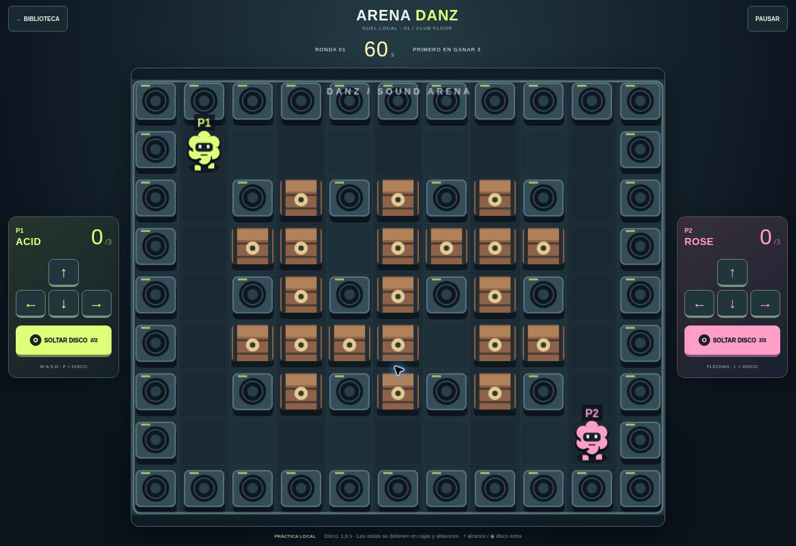

# Arena DANZ — primera beta local

15 de noviembre de 2026. Primer juego de los tres duelos aprobados: una arena
original inspirada en la mecánica de Bomberman, con arte y personajes DANZ propios.
Pilla-Pilla, Kart y salas online siguen pendientes. Los nuevos QR continúan aplazados.

## Mejoras aplicadas

| Área | Aplicado |
| --- | --- |
| Juego real | Dos jugadores, movimiento simultáneo, discos, cobertura destructible, cadenas, mejoras y victoria a tres rondas. El propio disco también elimina a su dueño. |
| Equidad | Mapa simétrico, salidas libres y resolución de destinos simultánea; no depende de qué jugador se procesa primero. |
| Arte | Club con altavoces, flight cases, vinilos y flores originales. Ilustración vectorial de 4,3 KB y gráficos procedurales sin descargas de texturas. Las portadas aprobadas de Jack y Groove se conservan. |
| Móvil | Diez botones de al menos 44 × 44 px, captura independiente de punteros, dos mandos y disparo mientras se mantiene el movimiento. Sin desplazamiento accidental sobre controles. |
| Pantalla | Vista dedicada; mandos a ambos lados en horizontal y juntos debajo del tablero en vertical. Salida y Escape devuelven la biblioteca. |
| Pausa | Al ocultar o desenfocar se pausa y se liberan dedos/teclas; reanudación explícita. Temporizadores y renderer se limpian al salir. |
| Rendimiento | Phaser 4.2.1 aislado en el módulo del juego: 1,38 MB / 363 KB gzip. El bundle principal solo crece unos 1,4 KB. Tablero estático redibujado al cambiar las cajas; HUD a 10 Hz. Bucle de render dormido en menús, pausas y fin de ronda; se despierta al jugar o redimensionar. |
| Reloj | Tiempo real en primer plano con pasos de simulación de hasta 50 ms. Una caída de FPS no estira la mecha del disco; reanudar descarta el tiempo de pausa. |
| Compatibilidad | Phaser AUTO, con Canvas 2D como alternativa. Sin shaders ni efectos exclusivos de WebGL; movimiento reducido sin rebote ni pulso. |
| PWA | Se prepara la arena y su cartel para uso sin conexión. Navegaciones públicas de `/test` y Arena reconocidas; se conservan exclusiones de credenciales, datos privados y parámetros desconocidos. |
| Herramientas | Documentación actual de Phaser consultada en Context7, fuente y estado verificados en GitHub/Vercel. Catálogo gratuito de Hugging Face consultado; no había un recurso de sprites que justificara integrar un servicio externo. |

## Comprobaciones

- Compilación de producción correcta. **186 pruebas internas superadas**, incluidas
  13 pruebas nuevas de reglas: simetría, movimiento simultáneo, límites, cobertura,
  cadenas simultáneas independientes del orden, daño propio, empates, pausa, revancha, mejoras y pureza del estado.
- En navegador: apertura real del juego, colocación de disco, eliminación propia,
  punto al rival y regreso a biblioteca comprobados.
- Marcos de 320 × 568, 390 × 844 y 844 × 390 sin desbordamiento. Botones de dirección
  medidos: 44, 55,67 y 45,33 px de ancho, respectivamente; todos 44 px de alto.
- Pruebas de navegador añadidas para entrada/salida, reloj, rondas, teclado,
  dos dedos más un tercer disparo, pausa, tamaños, Canvas 2D y arranque offline.
  El resultado actualizado se consulta en GitHub CI.
- La automatización de navegador local sigue limitada por los permisos del entorno;
  se usa el navegador conectado para la revisión y GitHub CI para Playwright.

## Propuestas pendientes

1. Validar comodidad con dos personas en un Android y un iPhone físicos.
2. Medir FPS, batería y arranque en dispositivos de gama baja; no se ha afirmado una medición física.
3. Afinar arte, efectos, sonidos opcionales y mapas tras probar esta beta.
4. Añadir salas online y reconexión en un bloque posterior, con validación de resultados.
5. Continuar después con Yeppo Pilla-Pilla y DANZ Kart Mini.

La beta es práctica local. No asigna DANZPOINTS ni guarda resultados competitivos.

