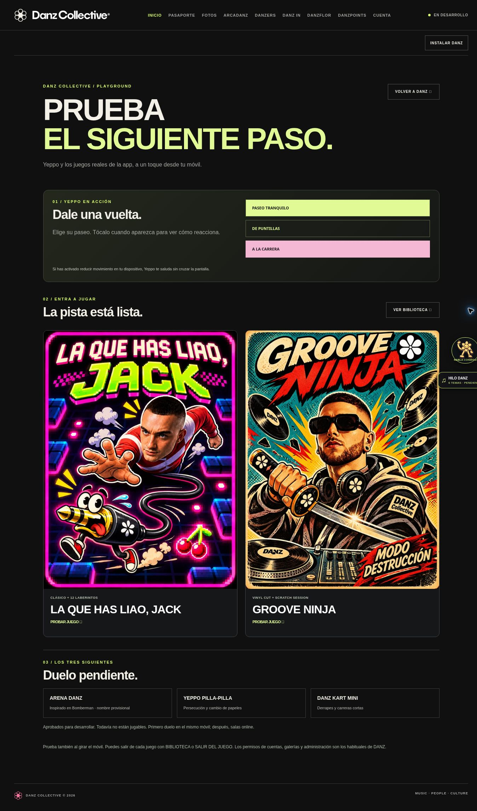

# Auditoría DANZ — 15/11/2026

Ámbito: biblioteca ARCADANZ, portadas aprobadas, paseos de Yeppo, `/test`, QR Studio
y reglas permanentes de trabajo. Los tres juegos nuevos son desarrollo pendiente.

## Mejoras aplicadas

| Área | Resultado |
| --- | --- |
| Portadas | Se usan los diseños aprobados de Jack y Groove, con sus protagonistas correctos. Se conservan los originales. |
| Carga móvil | Jack: 1.848.208 → 164.824 bytes, un 91,1 % menos. Groove: 2.638.868 → 312.356 bytes, un 88,2 % menos. Copias WebP de 720 px, sin cambiar el diseño. |
| Sin conexión | Se precargan las copias optimizadas; no los originales de 4,49 MB entre ambos. No se cachean solicitudes de QR, claves, galerías privadas ni callbacks de acceso. |
| Biblioteca | Una portada y entrada por juego. Jack y Groove abren una vista inmersiva con salida a la biblioteca. El contenido situado detrás de la presentación se oculta para evitar controles solapados. |
| Controles | Selección de modo y laberinto antes de jugar; mando opcional de Jack y sonido de Groove accesibles desde la presentación. |
| Competición | Se monta el tablero antes de abrir una partida clasificada desde la biblioteca. Cambiar un recorrido de práctica descarta el ticket anterior. |
| Yeppo | Mano alineada con una tarjeta visible, reacción sincronizada y cancelación al desplazar o redimensionar. Tres paseos y movimiento reducido; sin un bucle de render de React por cada fotograma. |
| Cierre táctil | El cierre del paseo queda fijo, fuera del personaje en movimiento, con una superficie de 44 × 44 px. El acceso a Yeppo se separa del reproductor para que ninguno tape al otro. |
| `/test` | Pantalla cargada bajo demanda, botones de paseo de 48 px y acceso a los juegos reales. Los juegos futuros se muestran como pendientes. No habilita permisos adicionales. |
| Pantalla estrecha | Eliminado el mínimo global de 320 px que provocaba desplazamiento lateral al disponer de 305 px útiles por la barra de desplazamiento. Los tres botones de Yeppo miden 48 px de alto. |
| QR Studio | Cliente Gradio únicamente en el servidor, Auth + MFA + permisos actuales, entradas acotadas, espera y cancelación, errores sin claves y descarga solo tras decodificar el contenido exacto. |
| Servidor Vercel | Configuración TypeScript en la raíz para el compilador de Functions, que no usa referencias de proyecto. Reescritura de extensiones e interoperabilidad de módulos; importación estática de PNG para que Vercel incluya la dependencia y cancelación de solicitudes activada. |
| Lectura de QR | Refuerzo local de contraste cuando el primer diseño IA no se lee, sin otra inferencia. Prueba real posterior: generación, descarga y lectura verificada en 35 segundos. |
| Reglas | `AGENTS.md` incorpora consulta de documentación, uso proactivo de complementos, prioridad gratuita, revisión táctil, ruta `/test` y auditoría antes de entregar. |

## Verificación realizada

- Compilación TypeScript y build de producción correctos.
- **180 pruebas de motor, datos, permisos, almacenamiento, pases, PWA y QR correctas**
  en el entorno local. Las siete de QR comprueban píxeles reales, destino distinto,
  secretos, tamaño, cancelación y permisos administrativos; no usan datos reales.
- Hugging Face: Space en ejecución, API `/inference` y parámetros comprobados en
  vivo; generación real gratuita sin token y lectura exacta del QR resultante.
- Navegador disponible: revisión visual de biblioteca, presentación de Jack,
  arranque y salida de una partida, y nueva pantalla `/test`. Groove abre Scratch
  Session, arranca con su marcador propio y vuelve a la biblioteca con Escape.
- QR clásico: formulario con datos sintéticos, imagen y enlace de descarga PNG
  comprobados en el navegador.
- Adaptación de `/test` comprobada en marcos de 320 × 568, 390 × 844 y 844 × 390.
  Anchos útiles de 305, 375 y 829 px, respectivamente: ninguno desborda; los tres
  botones de paseo conservan una altura de 48 px.
- GitHub CI confirma las 180 pruebas internas, el build y las 10 pruebas PWA y de
  uso sin conexión. Las pruebas completas de controles y navegación se ejecutan
  también en tres trabajos separados: escritorio, tableta y móvil.
- Compilación independiente de la función con las opciones TypeScript de la raíz:
  importaciones emitidas y ejecución comprobadas; GET devuelve 405 y POST sin
  sesión devuelve 401. La interfaz no recibe claves.
- En el navegador se completan y cierran los tres paseos desde `/test`. El acceso
  a Yeppo queda 24 px por encima del reproductor en la revisión de escritorio.
- La automatización Playwright local no puede arrancar Chromium por una restricción
  del entorno (`socket() failed: Operation not permitted`). No se ha cambiado la
  política de seguridad. Las pruebas actualizadas se ejecutan en GitHub CI.

## Complementos comprobados

| Complemento | Comprobación |
| --- | --- |
| GitHub | Lectura del repositorio privado, rama y commit actuales; escritura de recursos aprobados en objetos Git. |
| Vercel | Proyecto Vite y despliegue de producción actual identificados; se mantiene el proyecto existente. |
| Hugging Face | Catálogo, código del Space, configuración y generación real por su cliente oficial. |
| Context7 | Resolución y consulta de React y Phaser 4.2.1; limpieza de efectos, punteros multitáctiles y adaptación de pantalla. |
| Figma | Cuenta DANZ autenticada y capacidades consultadas. No hay un archivo Figma de este bloque identificado; no se afirma haber editado uno. |

Para futuras implementaciones 2D se evaluará Phaser; para Yeppo 3D, Three.js o
React Three Fiber compatible con React. No se han añadido esos motores a la app
actual. Las fuentes verificadas incluyen React, Phaser y las recomendaciones de
render bajo demanda de React Three Fiber.

## Propuestas pendientes

1. Medir FPS, consumo y respuesta en un Android físico y un iPhone físico.
2. Seguir dividiendo el bundle principal (aprox. 562 KB sin comprimir); el panel de
   pruebas y la administración ya se cargan por separado.
3. Desarrollar Arena DANZ (inspirado en Bomberman), Yeppo Pilla-Pilla y DANZ Kart
   Mini. Primero duelo local; salas online tras implementar sincronización y reconexión.
4. Añadir más controles o animación 3D solo después de comparar tamaño, batería,
   legibilidad e identidad con la versión actual.

La revisión de código y el resultado actualizado de CI están en
[PR #26](https://github.com/danzcollective26/danzcollectiveapp/pull/26).
La ruta de prueba del proyecto es
[`/test`](https://danzcollectiveapp.vercel.app/test).

Captura de la revisión visual del entorno de desarrollo, sin datos de asistentes:

