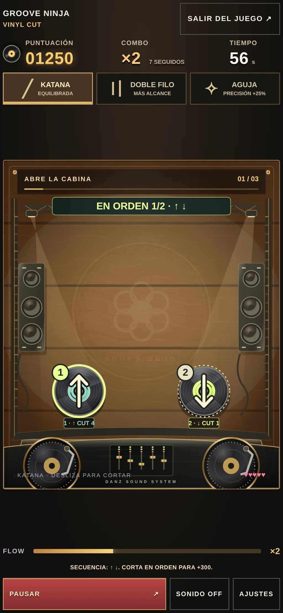
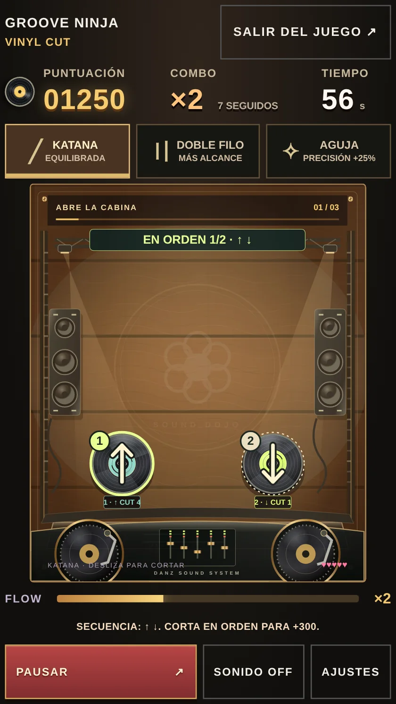
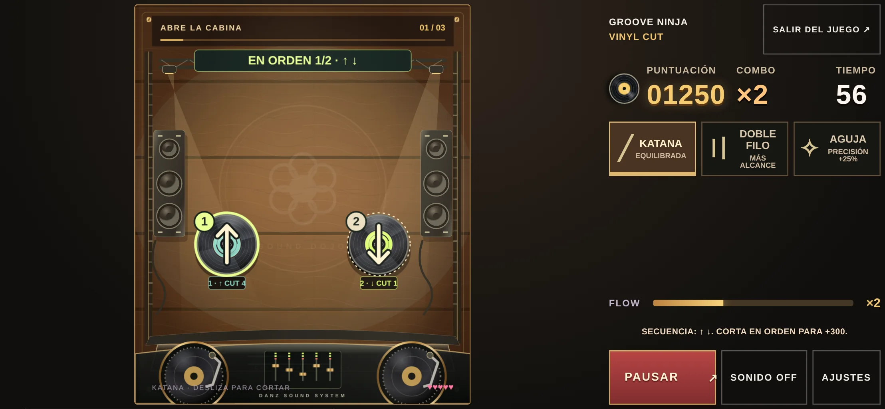

# Groove Ninja — cortes dirigidos y secuencias, 16/11/2026

G05: corte real arriba/abajo/izquierda/derecha y secuencias numeradas, sobre
Vinyl Cut. Trabajo realizado en PR 43, base main 5f8c72e.

## Cambios aplicados

- Flecha única, estable aunque el vinilo rote, con sentido exacto y tolerancia
  angular. Disco siguiente resaltado por contorno sólido y número; los siguientes
  conservan número y contorno discontinuo. No depende solo de color.
- Cada cuatro oleadas, dos objetivos ordenados; al final entran tres. Los
  primeros patrones son arriba/abajo, después hay izquierda/derecha.
- Cada disco dirigido vale el doble. Completar toda la secuencia da +300 una
  sola vez. Los multiplicadores y multicortes mantienen sus reglas locales.
- Orden/sentido incorrectos no cortan ni puntúan: permiten corregir antes de
  que caiga el vinilo. Perder una secuencia cuesta una vida para el grupo y
  retira los objetivos restantes; no deja un paso imposible de completar.
- Pausa conserva objetivo/tiempo. Hielo conserva el avance y evita crear otra
  secuencia mientras la anterior siga en vuelo. El final limpia los objetivos.
- Un segmento procesa los discos según el recorrido del gesto, para que barrer
  en orden inverso no cobre una secuencia por el orden de una lista interna.
- Flechas de teclado seleccionan sentido; 1–4 cortan el número CUT. Mayús + 1–4
  conserva el corte descendente. Scratch mantiene sus propios controles.
- Los desplazamientos pequeños se acumulan: un gesto lento puede cortar sin
  levantar el dedo. Tacto/mouse usan el mismo motor y conservan cancelación,
  captura de puntero, pausa al ocultar/perder foco y cambio de orientación.
- Ayuda del menú y /test actualizadas. Portadas exactas, Scratch, Destrucción,
  resto de la app y política de DANZPOINTS conservados.

## Verificación

Código inicial 6373360275efd7f73eaff2b91d04036944c4bfed.
CI 230: build, 253 pruebas internas, 564 escenarios de navegador (188 en cada
uno de escritorio/tableta/móvil) y 16 offline correctos, sin reintentos fallidos.

Siete pruebas nuevas de motor: cuatro sentidos y ejes, orden/bonus único,
orden físico de intersección, pérdida de grupo, pausa/final y última vida,
progresión real de oleadas y concurrencia bajo hielo.

Pruebas nuevas de navegador: tacto en sentido opuesto, orden incorrecto,
secuencia completa después de pausa, gesto lento sin levantar, flechas de
teclado y encaje/capturas en 320×568 y 844×390. Batería anterior conserva
armas, Combo Disc, Split Disc, Scratch, modos, audio, historial y salida.

Chromium local no puede crear su socket (Operation not permitted); el servidor
local arranca en 127.0.0.1, pero el navegador conectado está en otra máquina y
no alcanza ese puerto. La vista previa privada queda bloqueada por la política
del navegador; no se cambian accesos ni protecciones. CI ejecuta el juego real
y genera las capturas para la revisión visual.

## Rendimiento y límites

Sin dependencias nuevas, modelos remotos, llamadas extra, nuevos temporizadores
ni animaciones del indicador. El motor conserva su RAF y pausa/limpieza. Como
máximo tres indicadores y una cabecera de secuencia; efectos suaves y movimiento
reducido conservados. El build y la regresión miden la app de navegador, no el
rendimiento de un móvil físico.

T01 conserva teléfono Android/iPhone, comodidad, FPS, batería y audio escuchado.
G02/G03 conservan música/BPM reales; G04/G07 requieren evaluación de diversión
en sesiones largas, G08 competición. QR y entregas externas siguen aplazados o
pendientes según el registro general.

## Comprobar en la app

Abrir /test → Groove Ninja → Vinyl Cut → Jugar. La primera secuencia llega
tras las primeras oleadas: cortar el disco 1 hacia arriba y el 2 hacia abajo.
Probar primero el 2 o invertir el gesto: el vinilo sigue disponible. Pausar
tras el 1, reanudar y completar el 2: se muestra «Secuencia completa +300».

## Cierre de publicación y revisión visual

- PR 43 publicado: 2ac95f3c214ea0887e5b019449a76e4ec5b1793f. Producción
  READY dpl_5ycDvToiYvTxBDCUGPuApGFr9f5U y alias público comprobados.
- Capturas del juego real revisadas en 390×844, 320×568 y 844×390. Flechas
  nítidas e independientes del giro, orden numerado y siguiente objetivo claros,
  proporción del tablero conservada, sin recorte/desborde y controles de 44 px.
- La secuencia de tacto rechaza primero el disco 2 y luego el gesto descendente
  sobre el 1 ascendente. Tras corregir, pausar y reanudar, completa el grupo y
  suma el bonus una vez. El gesto lento y el control por teclado también pasan.
- Revisión pública conectada: ayuda actualizada, siete cortes, 1.250 puntos,
  cinco vidas y primera secuencia ↑/↓ observados; regreso a biblioteca correcto.
  La publicación pública es la misma funcionalidad verificada en CI 230.
- Sin gasto de puntos ni modificación de acceso, datos o recompensas. Se
  conservan portadas aprobadas y los estados de los demás pendientes.

Capturas de CI 230, no fotografías de dispositivos físicos:

