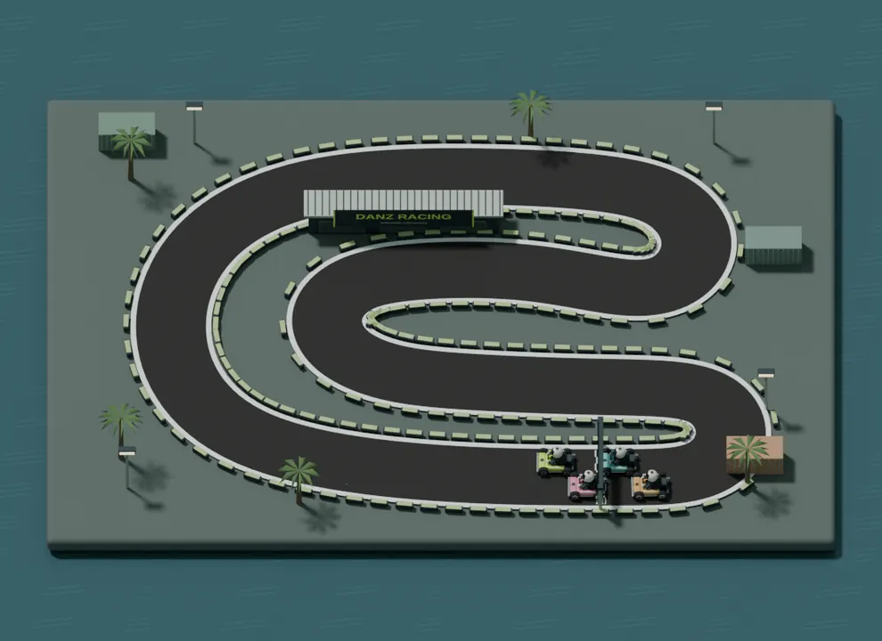

# DANZ Kart Mini — acabado 3D, 16/11/2026

El propietario solicita terminar Kart con un acabado muy cuidado y buscar los
recursos necesarios. El alcance es el juego local: Crew Race, Contrarreloj y
duelo en un mismo móvil. Online conserva su estado separado.

## Implementado y auditado; validación GPU pendiente

- Presentación 3D real en Three.js 0.186.0, con cámara de seguimiento o de toda
  la pista. Se conserva la integración física fija ya probada: no se migran los motores de
  Jack, Groove ni Collecta. Phaser queda disponible para la vista compatible.
- Kart original con carrocería redondeada, pintura barnizada, metal, neumáticos,
  piloto con casco/visera, volante y brazos. Cuatro carrocerías cosméticas.
- Circuitos con asfalto texturizado, normal map, pianos, barreras, garaje de la
  crew, contenedores, palmeras, focos y pórtico de salida. Iluminación ambiental,
  sombras y materiales. Minimap en seguimiento, velocímetro, huellas e impulso.
- Sonido original sintetizado de motor, ruedas, salida, impulso, vueltas y
  llegada. Arranca con el gesto de jugar y se suspende al pausar; se puede apagar.
- Ajustes persistentes: cámara, carrocería, sonido y calidad. Automático, ligero,
  alta y compatible 2D. En duelo se conserva vista de toda la pista y mandos
  enfrentados. Con reducir movimiento se usa vista estable sin huellas/fuego.
- Podio, clasificación de llegada, mejor vuelta y récord personal de sesión.
  No se conceden DANZPOINTS ni se inventan competiciones online.
- Objetivo de render 60 Hz, o 30 Hz en ligero; no equivale a FPS medidos en un
  móvil físico. Resolución acotada, instancias de barreras y texturas de 512 px.

## Recursos examinados y usados

| Recurso | Procedencia y licencia | Uso |
| --- | --- | --- |
| Asphalt Track | Poly Haven, Dimitrios Savva, CC0 | Difuso y normal OpenGL originales 1K, optimizados a WebP de 512 px; 32.108 y 10.576 bytes. Incorporados al repo y preparación offline. |
| Three.js 0.186.0 | Three.js, MIT | Renderer 3D local; licencia en `public/arcade/kart/CREDITS.txt`. |
| Car Kit / Racing Kit | Kenney, CC0 según páginas oficiales | Evaluados. Descarga del sitio devuelve 403 en este entorno; no incorporados ni presentados como usados. |
| Kart, piloto, escenario, señalética y audio | Creación original del proyecto | Modelado y síntesis locales, sin servicios externos en tiempo de juego. |

Fuentes: https://polyhaven.com/a/asphalt_track · https://polyhaven.com/license ·
https://api.polyhaven.com/files/asphalt_track · https://threejs.org/docs/ ·
https://kenney.nl/assets/car-kit · https://kenney-assets.itch.io/car-kit

No hay recursos de pago ni claves nuevas. Los mapas se descargaron mediante la
API pública y se sirven localmente. No se usa el render promocional de un autor
como textura ni se copia su logotipo. Las portadas de los otros juegos siguen intactas.

## Verificación

Build y **229 pruebas internas** correctos. Las nueve pruebas del motor Kart
incluyen carreras completas en ambos circuitos, pausa/salida, cadencias distintas,
contención, vueltas falsas, derrape/impulso, mandos independientes y separación de
asfalto/barreras. Otra prueba cubre preferencias corruptas o inaccesibles.

La auditoría de geometría con los modelos reales exportados a Blender/Cycles CPU
ha detectado un solapamiento de curvas en la primera versión. Se corrigen ambos
trazados con B-splines periódicas: radio mínimo 61,0/64,4 unidades y separación
entre tramos no vecinos 134,5/135,7 (carretera de 94 + barreras). Se ajustan el
garaje, la parrilla y el radio de contacto al tamaño del kart. Los récords del
nuevo trazado usan una clave v2, sin borrar los registros v1 del navegador.

Se agrupan piezas estáticas por material conservando ruedas y fuego animados;
las barreras y tejados se instancian. La escena exportada contiene unas 59.000
caras triangulares con cuatro karts. No es una medición de tiempo de GPU.

En el navegador conectado **WebGL está desactivado** (error del contexto con
GL_RENDERER Disabled). Se ha comprobado el fallback 2D automático, un solo canvas,
pausa sin avance, preferencias, carrocería, circuitos, sonido on/off y mandos
opuestos en tamaños 390×844 y 320×568. La geometría y cámaras se revisaron con
render local; ese render no es una captura ni una medición del renderer WebGL.
La revisión horizontal de producción y la publicación se anotarán al cerrar.

CI 200 falla antes de ejecutar pasos: cuatro jobs sin steps ni logs; causa sin
confirmar. No se cuentan los escenarios de navegador/offline como ejecutados.
T04 conserva esta regresión pendiente. T01 conserva WebGL real Android/iPhone,
comodidad multitoque, audio escuchado, FPS y batería. No se rebajan protecciones,
se activan costes ni se cambia la configuración del navegador para superar esto.

Atajos, objetos, fantasma, repetición y online no están implementados. El alcance
entregado es la carrera local de tres modos y dos circuitos; esos contenidos
adicionales siguen en la hoja de ruta.

Render de revisión de los modelos originales en Blender/Cycles CPU. Materiales
e iluminación aproximados; no es una captura de WebGL ni acredita FPS.
